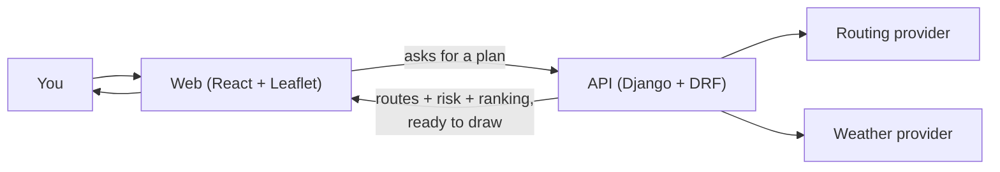
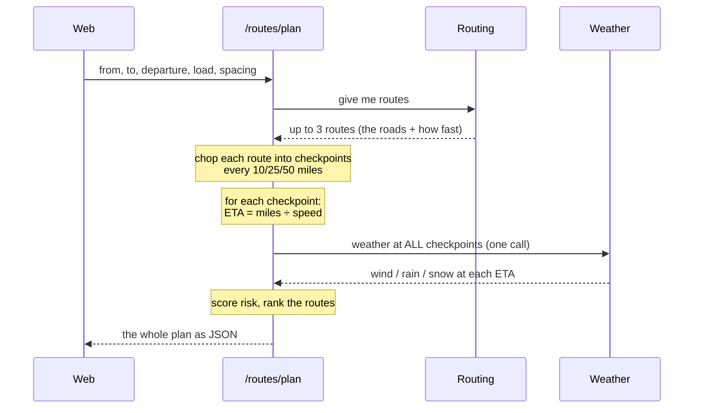
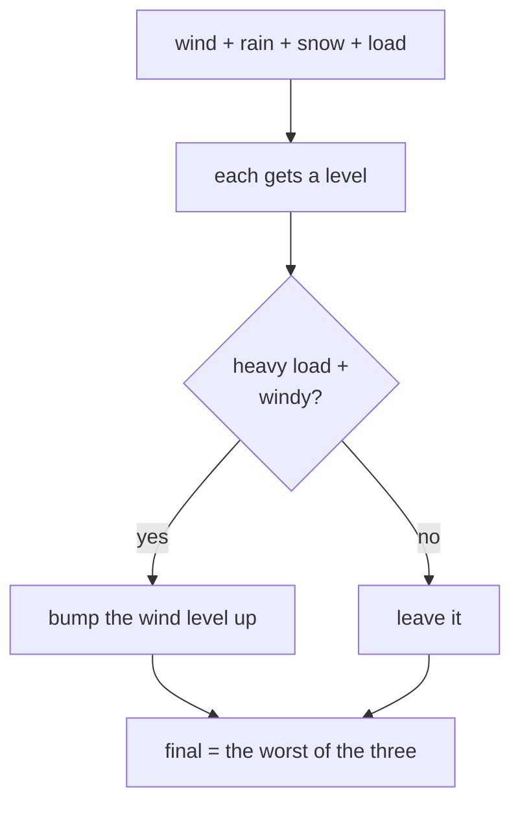
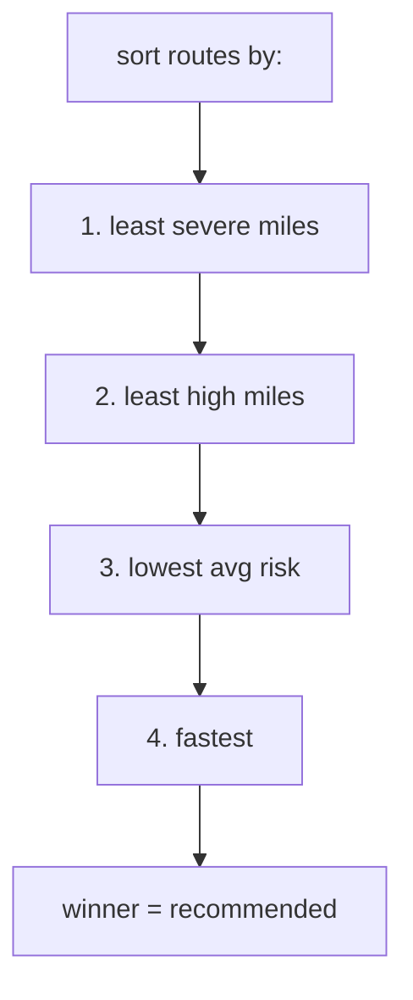
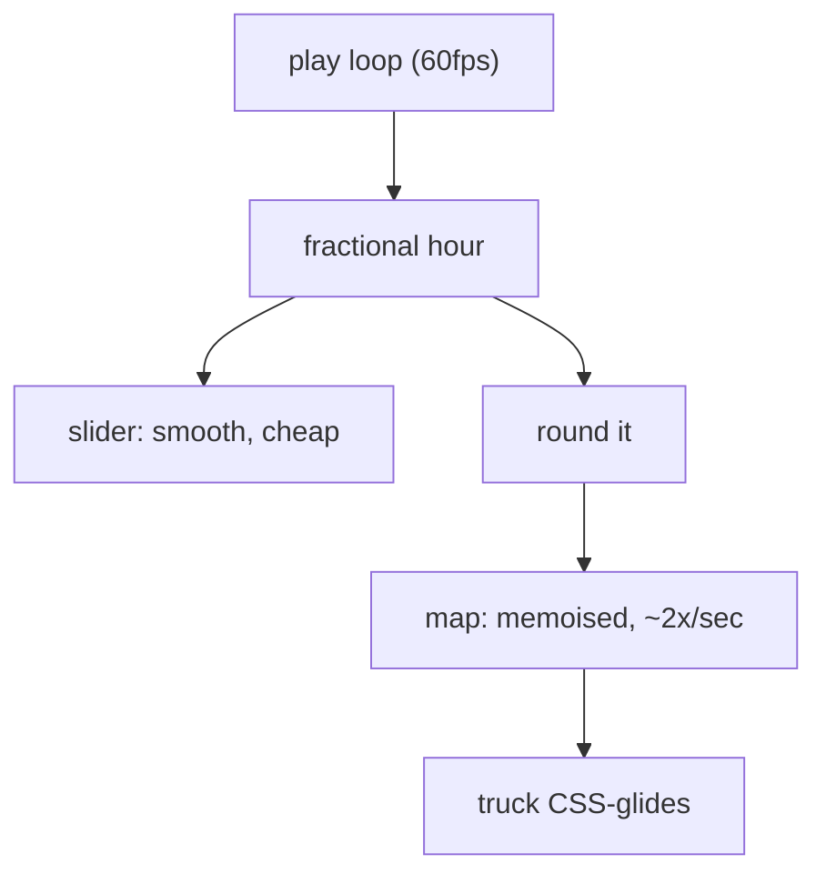

# The "let me catch you up before your quiz" doc

Okay. I built this whole thing, you're the one getting quizzed on it, so let me
just tell you how it works and what they're going to poke at. Read this once,
glance at the diagrams, and you'll be fine. I've marked the stuff they'll
*definitely* ask with **👉 if they ask**.

---

## What it even is (say this if they open with "walk me through it")

It's a **truck route planner that cares about the weather**. You type in where
you're starting, where you're going, when you're leaving, and how heavy the load
is. It gives you a few route choices, checks the weather *along each route*, scores
how risky each one is, and tells you which route to take. There's a map with the
routes coloured by risk, and a weather heatmap you can scrub through 48 hours.

The one sentence that makes you sound like you get it:

> "The backend does all the thinking — routing, weather, risk, ranking — and hands
> the frontend clean JSON. The frontend just draws it. No logic is duplicated
> across the two."

That's the whole philosophy. If you remember nothing else, remember that.



---

## How a plan actually happens (this is the money question)

If they ask "what happens when I hit Plan?" — here's the story. Walk through it
top to bottom, it's not complicated:



The thing to really *get* here is the **ETA part**, because it's the heart of the
assignment. Keep reading.

---

## The 4 things they're grading (and what to say for each)

They literally weight it: 40% logic, 40% map/smoothness, 15% code, 5% docs. So
spend your energy on the two 40s.

### ① Routes, weather, risk, recommendation — 40%

**Routes.** We ask a routing provider for up to 3 routes. Here's the honest
backstory you should have ready, because it's a great answer:

> "I wired up the real OpenRouteService API with the truck profile — real roads,
> real truck ETAs. But their free tier only gives you *alternative* routes for
> trips under 100 km, and a real haul like Dallas→Minneapolis is 1,600 km, so you
> only get one route back. The whole app is about *comparing* routes, so I default
> to a synthetic router that makes 3 plausible corridors, and kept the real one
> swappable. If you want real roads *and* 3 options, you self-host the routing
> engine — that removes the cap."

That answer shows you hit a real-world API limit and made a judgment call. That's
gold. Don't hide it, lead with it.

**Weather at the ETA — THIS IS THE ONE THEY CARE ABOUT.** 👉 if they ask only one
thing, it's this. The trick is: we don't check the weather *now*. We check it for
*when the truck will actually be at that spot*.

```
ETA to this checkpoint = miles so far ÷ route speed
the time the truck is there = departure time + ETA
→ look up the weather for THAT hour
```

So mile 500 on a 60 mph route gets scored against the forecast **8 hours after you
leave**, not right now. Say exactly that. It's what makes it a *routing* weather
tool instead of a weather app.

**One perf thing to casually drop:** instead of calling the weather API once per
checkpoint (~120 calls, took 38 seconds, kept timing out), I **batch all the
checkpoints into one call** — about 1 second now. If they ask about performance on
the backend, that's your answer.

**Risk rules.** Each checkpoint gets a risk level 0–4 by taking the **worst of
wind, rain, snow**. Memorize the shape, not the exact numbers:

| Level | Wind | Rain | Snow |
|---|---|---|---|
| Low | under ~25 mph | light | light |
| Moderate | 25–34 | … | … |
| High | 35–44 | … | … |
| Severe | 45–54 | … | … |
| No Travel | 55+ | heavy | heavy |

Then the **load rules** bump wind up for heavy trucks (wind pushes a loaded
trailer around):
- strong wind (45–54) + over 30,000 lb → **No Travel**
- medium wind (35–44) + over 40,000 lb → **Severe**



If they ask "where does this logic live?" → one function on the backend
(`scoring.classify`), reused by both the route checkpoints *and* the heatmap, so
they can't disagree. That's a code-quality point too.

**Recommendation.** We sort the routes by, in order: **fewest severe miles →
fewest high miles → lowest average risk → shortest time.** First one wins. So a
slightly slower route that dodges bad weather beats a fast risky one — which is the
"balance risk and time" thing they asked for.



👉 if they ask "how do you know why it picked that one?" → we return which rule
broke the tie, and the UI shows a little **"Why this route?"** table. It's
explainable, not magic.

### ② Map & heatmap smoothness — the other 40%

This is where you can really shine because there's a good *story* here.

**On the map:** the chosen route is drawn as little coloured segments (each bit
coloured by its risk), checkpoints are dots, there's a truck marker, and the
heatmap is an image layer underneath. The backend sends the raw road + checkpoints;
the frontend figures out *where the colour changes* by slicing the line between
checkpoints. (Rendering detail, not something the API encodes — nice separation.)

**The heatmap:** backend returns a grid of risk levels over the area for each hour;
the frontend fades it to the route corridor, colours it, and blurs it onto the map.

👉 if they ask "why is the heatmap grid fake when the checkpoints are real?" →
real answer: a real per-cell forecast is ~5,800 lookups *per frame* — no weather
API does that. The **checkpoints that actually drive the decision are real**; the
background heatmap is a smooth approximation. Approximating the *expensive,
decision-irrelevant* part on purpose is the right call, and saying that out loud
is the point.

**Now the smoothness story — learn this one, it's impressive:**

The forecast slider plays 0→48h, moving the truck and the heatmap. First version
was janky. Here's why and how I fixed it:

- The problem: if the "current hour" updates 60 times a second and the *whole map*
  re-renders on it, Leaflet re-processes ~150 layers every frame → chugs.
- The fix: **split the clock.** The slider uses a smooth fractional hour (60fps),
  but the map gets the *rounded* hour and is memoised, so it only updates ~twice a
  second. The **truck CSS-glides** between those steps so it still looks smooth,
  and I precompute the heatmap frames so scrubbing is instant.



**Bonus bug story** (if they ask about a tricky bug): the truck used to *blink* —
disappear and reappear — while playing. Turned out the markers had no React `key`,
so when the heatmap layer popped in and out, react-leaflet matched the map's
children *by position* and kept destroying + rebuilding the truck. Adding a stable
`key` fixed it. Tells them you can debug React reconciliation.

### ③ Code quality — 15%

Quick hits if they poke:
- The risk/routing/weather math is **plain functions, no framework**, so it's unit
  tested on its own.
- **Provider pattern:** synthetic vs real (ORS / Open-Meteo) sit behind the same
  interface, picked by a setting. That's how I built the whole thing with *no API
  keys* and flipped to real later with one config line.
- The backend is **stateless — no database, no models** — it just computes and
  returns. (A DB would only show up if we saved trips/users.)
- **Tests are offline:** the real providers are tested with *mocked* HTTP so the
  suite is deterministic.
- If weather goes down, the plan **doesn't crash** — checkpoints just show "no
  data" (grey) and you still get routes + ETAs.

### ④ Docs — 5%

That's this file + `docs/API.md` (the full request/response contract). Easy.

---

## The "why did you…?" cheat sheet

They'll push on decisions. Here are the answers, with the trade-off (always
mention the trade-off, it sounds mature):

| If they ask… | You say… |
|---|---|
| Why backend-heavy? | One source of truth, map + ranking can't disagree, easy to test. Trade-off: frontend needs the API up. |
| Why synthetic routing? | ORS free tier caps alternatives at 100 km, so long trips = 1 route; I need 3 to compare. Real roads come back by self-hosting or short trips. |
| Why fake heatmap grid? | A real per-cell grid is ~5,800 lookups/frame — infeasible. The decision-driving checkpoints are real. |
| Why one big weather call? | 120 calls → 1; 38s → ~1s; dodges rate limits. |
| Why sample at the ETA? | It's a *routing* tool — you want the weather *when the truck is there*. |
| How'd you keep the slider smooth? | Fractional hour drives only the slider; map gets a rounded hour + is memoised; truck CSS-glides. |
| Everything UTC? | Times are UTC on the wire, converted to your local time in the UI — no ambiguity. |

---

## Stuff to NOT get caught off guard by (the honest bits)

- **The routing is synthetic by default.** If they go "so these aren't real
  roads?" — "Correct, because the free routing tier won't give 3 alternatives on
  long trips; the real integration is there and swappable." Confident, not
  apologetic.
- **The heatmap is an approximation.** Same energy — it's a deliberate call, not a
  miss.
- **It needs the backend running.** It's not a static demo; the frontend talks to
  Django for everything (places, routes, weather). If the API's down you get a
  "can't reach the service" screen — on purpose, no fake fallback data.

---

## 30-second version (read this last, right before you go in)

> Truck router that scores weather along the route. Backend generates routes,
> chops them into checkpoints, and checks the weather **at the truck's ETA** at
> each point — worst of wind/rain/snow, bumped up for heavy loads — then ranks
> routes by severe miles, high miles, average risk, then time. Frontend (React +
> Leaflet) draws the routes coloured by risk, the checkpoints, a moving truck, and
> a 0–48h weather heatmap you can scrub. Two things I'm proud of: batching ~120
> weather lookups into one call so a plan takes ~1 second, and keeping the
> animation smooth by running the slider at 60fps but the memoised map at ~2fps
> with a CSS-glided truck. Real vs fake data is behind a provider switch, so it was
> built keyless and flipped to real (OpenRouteService + Open-Meteo) with a config
> change.

You got this. 🚚
