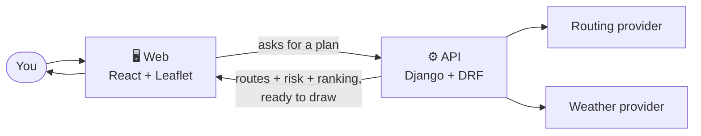
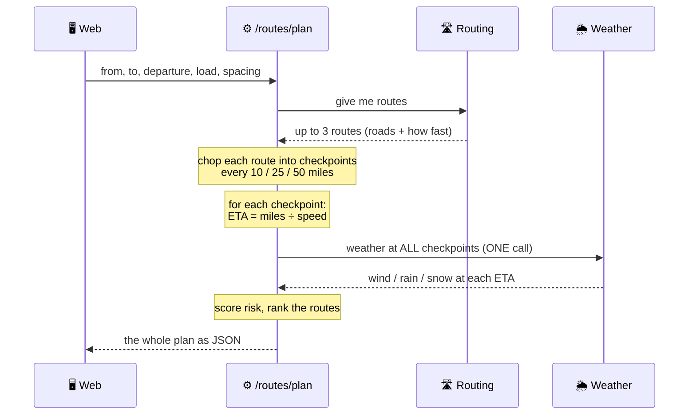
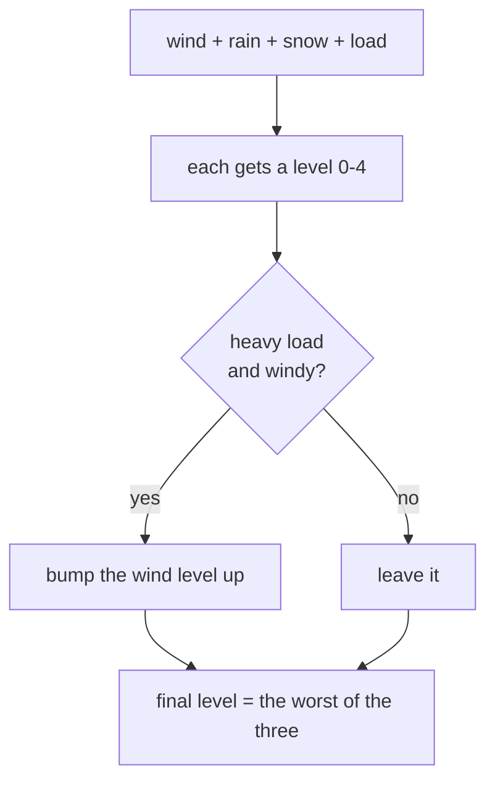
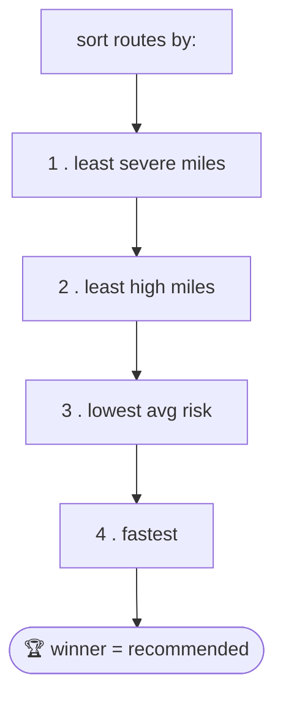
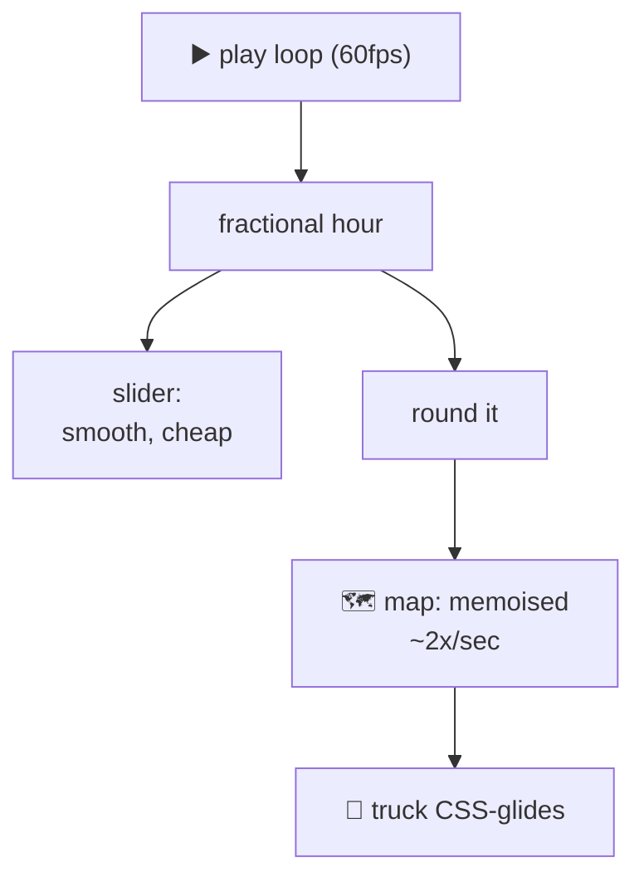

<div align="center">

# 🚚 Truck Routing — Walkthrough & Cram Sheet

**Your friend built the whole thing. Here's everything you need to pass the quiz.**

</div>

> [!NOTE]
> Read this once, glance at the diagrams, skim the 30-second version right before
> you walk in. The boxes marked **💡 If they ask** are ready-made answers — just
> say them. Everything here is honest, including the trade-offs (that's usually
> what they're really probing).

---

## 📍 Contents

1. [What it even is](#-what-it-even-is)
2. [How a plan happens](#-how-a-plan-happens-the-money-question) ← the money question
3. [What they grade](#-what-theyre-grading)
   - [① Routes, weather, risk & recommendation (40%)](#-routes-weather-risk--recommendation--40)
   - [② Map & heatmap smoothness (40%)](#-map--heatmap-smoothness--the-other-40)
   - [③ Code quality (15%)](#-code-quality--15)
   - [④ Docs (5%)](#-docs--5)
4. [The "why did you…?" cheat sheet](#-the-why-did-you-cheat-sheet)
5. [Don't get caught off guard](#-dont-get-caught-off-guard)
6. [30-second version](#-30-second-version)

---

## 🧠 What it even is

A **truck route planner that cares about the weather**. You enter where you're
starting, where you're going, when you leave, and how heavy the load is. It gives
you a few route options, checks the weather *along each route*, scores how risky
each one is, and tells you which to take — on a map, with a scrubable 48-hour
weather heatmap.

> [!TIP]
> **The one sentence that makes you sound like you get it:**
> *"The backend does all the thinking — routing, weather, risk, ranking — and
> hands the frontend clean JSON. The frontend just draws it. No logic is
> duplicated across the two."*
>
> If you remember nothing else, remember that.



---

## 🔄 How a plan happens (the money question)

If they ask *"what happens when I hit Plan?"* — walk this top to bottom. It's not
complicated:



The part to really *get* is the **ETA step** — it's the heart of the assignment.
Keep reading. 👇

---

## 🎯 What they're grading

They literally weight it. Spend your energy on the two 40s.

| Weight | Area |
| :---: | --- |
| **40%** | Routes, weather, risk & recommendation logic |
| **40%** | Map & heatmap smoothness and performance |
| 15% | Code quality |
| 5% | Docs & walkthrough |

---

### ① Routes, weather, risk & recommendation — 40%

#### 🛣️ Routes

We ask a routing provider for up to 3 routes. Here's the backstory to have ready —
it's a great answer because it shows judgment:

> [!TIP]
> **💡 If they ask about the routing API:**
> *"I wired up the real OpenRouteService API with the truck profile — real roads,
> real truck ETAs. But its free tier only returns **alternative** routes for trips
> under 100 km, and a real haul is 1,600 km, so you only get one route back. The
> whole app is about **comparing** routes, so I default to a synthetic router that
> makes 3 plausible corridors, and kept the real one swappable. Self-host the
> routing engine and the cap goes away."*
>
> Lead with this — don't hide it. Hitting a real API limit and making a call is
> exactly what they want to see.

#### 🌦️ Weather at the ETA — ⭐ THE ONE THEY CARE ABOUT

We don't check the weather *now*. We check it for *when the truck will actually be
at that spot*.

```
ETA to this checkpoint       = miles so far ÷ route speed
clock time the truck is there = departure time + ETA
→ look up the weather for THAT hour, at THAT spot
```

So mile 500 on a 60 mph route is scored against the forecast **8 hours after you
leave**, not right now.

> [!IMPORTANT]
> **Where does "speed" come from? The user doesn't give it — the *route* does.**
> The real router returns the route's distance + duration (so `speed = distance ÷
> duration`); synthetic routes have a speed baked in. Either way, by the time we
> sample checkpoints we know the speed, and ETA is just `miles ÷ speed`.

> [!TIP]
> **💡 If they ask about backend performance:**
> *"Naïvely you'd call the weather API once per checkpoint — ~120 calls, took 38
> seconds and hit rate limits. I batch **every checkpoint across all routes into
> one call**, so a plan is ~1 second."*

#### ⚡ Risk rules

Each checkpoint gets a level **0–4**, taking the **worst of wind / rain / snow**.
Learn the shape, not the exact numbers:

| Level | Wind | Rain | Snow |
| --- | --- | --- | --- |
| 🟢 Low | under ~25 mph | light | light |
| 🟡 Moderate | 25–34 | … | … |
| 🟠 High | 35–44 | … | … |
| 🔴 Severe | 45–54 | … | … |
| 🟣 No Travel | 55+ | heavy | heavy |

Then **load rules** bump wind up for heavy trucks (wind shoves a loaded trailer):

- strong wind (45–54) **+** over 30,000 lb → **No Travel**
- medium wind (35–44) **+** over 40,000 lb → **Severe**



> [!TIP]
> **💡 If they ask where this lives:** one function on the backend
> (`scoring.classify`), reused by both the route checkpoints **and** the heatmap —
> so they can't disagree. (That's a code-quality point too.)

#### 🏆 Recommendation

Sort the routes by — in order — **fewest severe miles → fewest high miles → lowest
average risk → shortest time.** First one wins. So a slightly slower route that
dodges bad weather beats a fast risky one — which is the "balance risk and time"
ask.



> [!TIP]
> **💡 If they ask "how do you know *why* it picked that?"** We return which rule
> broke the tie, and the UI shows a little **"Why this route?"** table. Explainable,
> not magic.

---

### ② Map & heatmap smoothness — the other 40%

This is where you can shine, because there's a good *story*.

#### 🗺️ On the map

The chosen route is drawn as little **coloured segments** (each bit coloured by its
risk), checkpoints are dots, there's a truck marker, and the heatmap sits
underneath. The backend sends the raw road + checkpoints; the frontend figures out
*where the colour changes* by slicing the line between checkpoints. *(Rendering
detail, not something the API encodes — nice separation.)*

#### 🌡️ The heatmap

Backend returns a grid of risk levels over the area for each hour; the frontend
fades it to the route corridor, colours it, and blurs it onto the map.

> [!TIP]
> **💡 If they ask "is the heatmap real?" → yes, but *coarse*,** and there's a nice
> story: a fine grid (0.2°) is ~5,800 cells — thousands of API lookups per frame,
> infeasible. The insight: **Open-Meteo returns a location's *entire* 48-hour
> forecast in one call.** So I fetch a **coarse ~230-cell grid in a single batched
> call** — the whole real field across space *and* all 48 hours — then upscale and
> blur it. **Coarse-but-real beats fine-but-fake.**
>
> And you *can't* build it from the checkpoints — they're a space-*time* diagonal
> (position and clock advance together), so at any single hour you only have real
> weather for ~one point.

#### ✨ The smoothness story — learn this one

The slider plays 0→48h, moving the truck and the heatmap. First version was janky.

> [!CAUTION]
> **The trap:** if "current hour" is a 60fps value and the *whole map* re-renders
> on it, react-leaflet re-diffs ~150 layers **every frame** → thousands of
> `setStyle` calls/sec → jank.

**The fix — split the clock:**



- **Fractional hour** drives only the lightweight slider (smooth thumb).
- The map gets the **rounded** hour and is `React.memo`'d → re-renders ~2×/sec, not
  60. The side panel is memoised too.
- The **truck CSS-glides** between integer steps, so it looks continuous without a
  60fps re-render.
- Heatmap frames are **precomputed + cached**, so scrubbing is instant.

> [!TIP]
> **💡 Bonus bug story (if they ask about a tricky bug):** the truck used to
> *blink* — disappear and reappear — on play. The markers had no React `key`, so
> when the heat layer popped in/out, react-leaflet matched the map's children *by
> position* and kept destroying + rebuilding the truck. A stable `key` fixed it.
> → "I can debug React reconciliation."

---

### ③ Code quality — 15%

- 🧩 The risk/routing/weather math is **plain functions, no framework** → unit
  tested in isolation.
- 🔌 **Provider pattern:** synthetic vs real (ORS / Open-Meteo) behind one
  interface, picked by a setting. That's how I built it all **keyless** and flipped
  to real later with one config line.
- 🗄️ The backend is **stateless — no database, no models** — it just computes and
  returns.
- 🧪 **Tests are offline:** the real providers are tested with *mocked* HTTP, so the
  suite is deterministic.
- 🛟 **Graceful degradation:** if weather is down, the plan **doesn't crash** —
  checkpoints show "no data" (grey + a banner) and routes/ETAs still return.

### ④ Docs — 5%

This file + [`API.md`](API.md) (the full request/response contract). Done. ✅

---

## ❓ The "why did you…?" cheat sheet

Always mention the trade-off — it sounds mature.

| If they ask… | You say… |
| --- | --- |
| Why backend-heavy? | One source of truth; map + ranking can't disagree; easy to test. *Trade-off: frontend needs the API up.* |
| Why synthetic routing? | ORS free tier caps alternatives at 100 km → long trips = 1 route; I need 3 to compare. Real roads come back via self-host / short trips. |
| Is the heatmap real? | **Yes, but coarse** — fine grid = ~5,800 cells (infeasible); I fetch a coarse ~230-cell grid in one call (Open-Meteo gives each cell's full 48h) and blur it. |
| Why one big weather call? | 120 calls → 1; 38s → ~1s; dodges rate limits. |
| Why sample at the ETA? | It's a *routing* tool — you want the weather *when the truck is there*. |
| How's the slider smooth? | Fractional hour drives only the slider; map gets a rounded hour + is memoised; truck CSS-glides. |
| Everything UTC? | UTC on the wire, converted to your local time in the UI — no ambiguity. |

---

## ⚠️ Don't get caught off guard

> [!WARNING]
> These are the "honest bits." Say them **confidently, not apologetically** — they're
> deliberate calls, not misses.

- **Routing is synthetic by default.** *"Correct, these aren't real roads — the free
  routing tier won't give 3 alternatives on long trips. The real integration is
  there and swappable."*
- **The heatmap is real but coarse.** *"Real Open-Meteo data on a coarse grid,
  blurred; a fine real grid would be thousands of lookups per frame."*
- **It needs the backend running.** Not a static demo — the frontend talks to Django
  for everything. If the API's down you get a "can't reach the service" screen, on
  purpose, with no fake fallback data.

---

## ⏱️ 30-second version

> [!NOTE]
> Read this last, right before you go in.

> Truck router that scores weather along the route. The **backend** generates
> routes, chops them into checkpoints, and checks the weather **at the truck's ETA**
> at each point — worst of wind/rain/snow, bumped up for heavy loads — then ranks
> routes by severe miles, then high miles, then average risk, then time, and returns
> clean JSON. The **React/Leaflet frontend** draws the routes coloured by risk, the
> checkpoints, a moving truck, and a 0–48h weather heatmap you can scrub. Two things
> I'm proud of: **batching ~120 weather lookups into one call** so a plan takes ~1
> second, and keeping the animation smooth by running the **slider at 60fps but the
> memoised map at ~2fps** with a CSS-glided truck. Real-vs-synthetic sits behind a
> **provider switch**, so it was built keyless and flipped to real (OpenRouteService
> + Open-Meteo) with a config change.

<div align="center">

**You got this. 🚚💨**

</div>
