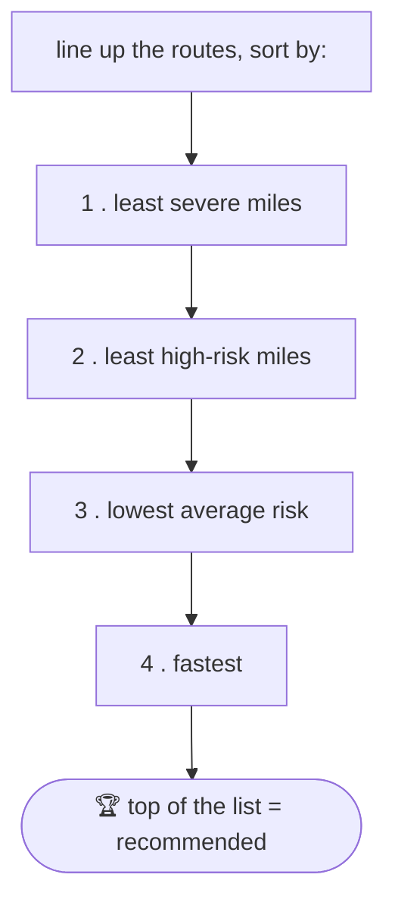

<div align="center">

# 🚚 Truck Routing — Explained Simply

**I built this. You're getting quizzed on it. Let me explain it like you've never seen the code — because you haven't.**

</div>

> [!NOTE]
> No assumed knowledge. I define every word the first time I use it. Read it once,
> and the boxes marked **💡 Say this** are literally what to say if they ask.

---

## Contents
1. [What the app does](#what-the-app-does)
2. [The two halves: screen + brain](#the-two-halves-screen--brain)
3. [How it figures out a plan (step by step)](#how-it-figures-out-a-plan-step-by-step)
4. [The map and the smooth animation](#the-map-and-the-smooth-animation)
5. [The weather heatmap](#the-weather-heatmap)
6. [The honest bits (don't get caught off guard)](#the-honest-bits-dont-get-caught-off-guard)
7. [Quick Q&A](#quick-qa)
8. [30-second version](#30-second-version)

---

## What the app does

You tell it: **where you're starting, where you're going, when you're leaving, and
how heavy your truck is.** It then:

1. Comes up with a few possible routes.
2. Checks the **weather along each route** — not right now, but *for the time the
   truck will actually be at each spot*.
3. Decides how **dangerous** each route is (wind, rain, snow — worse for a heavy
   truck).
4. **Recommends** the safest one, without making it way slower.
5. Shows it all on a **map**, plus a **weather "heat" cloud** you can play forward
   through the next 48 hours.

That's the whole product. Everything below is *how*.

---

## The two halves: screen + brain

Every app like this has two parts that talk to each other over the internet:

| Part | Plain-English | In our app |
| --- | --- | --- |
| **Frontend** | The screen you look at and click. Runs in your browser. | React + a map library called Leaflet |
| **Backend** | The "brain" running on a server somewhere else. Does the real work. | Python (Django) |

Think of a **restaurant**: the **frontend is the dining room** (menus, tables, what
you see), the **backend is the kitchen** (where the food is actually made). They
talk through a **waiter** — in software that's called an **API** (just a way for
the screen to ask the brain questions and get answers back).

> [!TIP]
> **💡 Say this if they ask about the design:**
> *"The backend does all the thinking — routes, weather, risk, which one to
> recommend — and sends the frontend simple, ready-to-draw answers. The frontend
> just draws them. I deliberately kept all the brains in one place so the two sides
> can't disagree."*


---

## How it figures out a plan (step by step)

This is the important part. Go slowly; each step is simple on its own.

### Step 1 — Get some routes

A **route** is just the path from A to B. To get real paths, the backend asks a
**routing service** — think of it as *Google Maps directions, but as a tool our
code can call*. You give it two points, it gives you back the roads to follow and
**how long the drive takes**.

> [!IMPORTANT]
> **The tricky bit people miss: the user never types in a speed.** The *routing
> service tells us* how far the route is and how long it takes — so we can work out
> the speed ourselves (distance ÷ time). The route "knows" its own speed.

Why do we want **3** routes? So we can *compare* them and pick the safest. (More on
a real-world snag with this in step 1b.)

### Step 1b — A real-world catch (good story for the quiz)

We hooked up a real routing service (**OpenRouteService**) with a *truck* setting,
so it respects things like truck weight limits. **But** its free plan only gives
you multiple route choices for *short* trips (under 100 km). A real long haul comes
back as just **one** route — and the whole point is to compare several.

So we use a **"made-up" router by default** that produces three believable routes,
and kept the real one as an easy swap for short trips.

> [!TIP]
> **💡 Say this:** *"The free tier of the real router won't give you 3 options on
> long trips, and comparing routes is the whole point — so I generate 3 plausible
> routes myself and kept the real router swappable. Hitting that limit and working
> around it is the honest engineering."*

### Step 2 — Drop "checkpoints" along each route

We can't check the weather at every inch of road, so we drop a **checkpoint** (just
an imaginary mile-marker) every so often — **every 10, 25, or 50 miles** (you pick).
Each checkpoint is a spot where we'll look up the weather.

### Step 3 — Work out *when* the truck reaches each checkpoint

This is the heart of the assignment, and it's just division.

**ETA** = *Estimated Time of Arrival* = *when the truck gets to a spot.*

```
time to reach a checkpoint  =  miles driven so far  ÷  the route's speed
clock time the truck is there  =  your departure time  +  that time
```

**Example** — a 60 mph route, leaving at **6:00 AM**:

| Checkpoint | Miles in | Time to get there | Clock time |
| --- | --- | --- | --- |
| Start | 0 | 0 hrs | 6:00 AM |
| Mile 300 | 300 | 300 ÷ 60 = 5 hrs | 11:00 AM |
| Mile 600 | 600 | 600 ÷ 60 = 10 hrs | 4:00 PM |

So the truck hits mile 600 around **4 PM**. That's the time we'll check the weather
for — see the next step.

### Step 4 — Check the weather *for that future time* (not "now")

Here's what makes it a *routing* tool and not a weather app: for mile 600, we don't
look up the weather *now* — we look up the forecast **for 4 PM, at that spot**,
because that's when the truck is actually there.

> [!TIP]
> **💡 Say this (this is the #1 thing they want to hear):**
> *"For each checkpoint I take its ETA — miles divided by the route's speed — add it
> to the departure time, and look up the forecast **for that exact hour at that
> exact spot**. So I'm scoring the weather the truck will *actually* hit, not the
> weather right now."*

**A speed/performance detail worth dropping:** the simple way would be to call the
weather service once per checkpoint — that's ~120 calls, it took **38 seconds** and
kept getting blocked for being greedy. Instead we ask for **all the checkpoints at
once in a single request**, which takes about **1 second**.

> [!TIP]
> **💡 Say this if they ask about performance on the backend:** *"I batch every
> checkpoint into one weather request instead of ~120 separate ones — 38 seconds
> down to about 1 second."*

### Step 5 — Turn weather into a risk level

Each checkpoint gets a danger level from **0 to 4**, by taking **whichever is worst**
— wind, rain, or snow:

| Level | Meaning | Rough trigger |
| --- | --- | --- |
| 🟢 0 | Low | calm |
| 🟡 1 | Moderate | breezy / drizzle |
| 🟠 2 | High | strong wind / steady rain |
| 🔴 3 | Severe | very strong wind / heavy |
| 🟣 4 | No Travel | dangerous |

Then two **load rules** make it stricter for heavy trucks (a strong wind shoves a
loaded trailer around):

- strong wind **+** a very heavy load → bump up to **No Travel**
- medium wind **+** a heavy load → bump up to **Severe**

### Step 6 — Pick the best route

We line the routes up and sort them by this priority (safety first, speed as the
tie-breaker):

1. Fewest **severe** miles
2. Then fewest **high-risk** miles
3. Then **lowest average** risk
4. Then **fastest**

The one at the top wins. So a route that's a little slower but avoids the bad
weather beats a fast but dangerous one — which is exactly "balance risk and time."



> [!TIP]
> **💡 Say this if they ask "how do you justify the pick?":** *"I show a little
> table of which rule actually decided it, so the recommendation is explainable, not
> a black box."*

---

## The map and the smooth animation

### What's on the map
The route drawn as a line **coloured by risk** (green→red as it gets dangerous),
the checkpoint dots, a little **truck** marker, and the weather cloud underneath.

### Why "smoothness" was tricky (this is a great story)

There's a slider that plays the forecast forward over 48 hours — as it plays, the
truck moves along the road and the weather cloud changes.

First version was **janky** (stuttery). Here's the plain-English why: the screen has
to **redraw** to show movement. Redrawing is work. The map has a *lot* of stuff on it
(the route, ~100 dots, cities…). If you redraw **the entire map 60 times a second**,
that's like **repainting your whole house every time you nudge one picture frame** —
way too much, so it stutters.

**The fix:** don't redraw the whole map constantly. Instead:
- Let the **slider** update super smoothly (it's tiny, cheap to redraw).
- Tell the **map** to only redraw about **twice a second** (your eye can't tell the
  difference for a weather cloud that changes slowly).
- Make the **truck glide** smoothly between those updates using a simple animation
  trick (like a CSS transition — the browser slides it for us), so it *looks*
  continuous even though the map itself isn't redrawing 60 times a second.

> [!TIP]
> **💡 Say this if they ask about map performance / smoothness:** *"Redrawing the
> whole map every animation frame was too heavy and stuttered. So I let the
> lightweight slider update smoothly, had the map update only ~twice a second, and
> let the truck glide between those steps with a CSS animation. Looks smooth, but the
> heavy part barely works."*

> [!TIP]
> **💡 Bonus bug story (if they ask about a hard bug):** *"The truck used to blink —
> vanish and reappear — while playing. The map was accidentally throwing the truck
> away and rebuilding it every frame instead of just moving it. Giving it a stable
> ID fixed it."* (Shows you can debug tricky UI stuff.)

---

## The weather heatmap

The **heatmap** is the coloured **cloud** behind the route — it shows where the bad
weather is across the whole region, and it animates over 48 hours.

To colour a whole region, you chop it into a **grid** — a checkerboard of little
squares — and colour each square by its weather risk.

> [!TIP]
> **💡 Say this if they ask "is the heatmap real weather?" → "Yes, but low-detail."**
> *"A fine grid is ~5,800 squares — getting real weather for each one, for every
> hour, would be thousands of lookups, which no weather service allows. The trick: one
> request to Open-Meteo gives a spot's **entire 48-hour** forecast. So I ask for a
> **coarse** grid (~230 squares) in **one** request — that's real weather across the
> whole area and all 48 hours — then blur it so it looks smooth. Low-res but real."*

Why can't we just reuse the checkpoint weather we already have? Because the
checkpoints follow the truck — as the truck drives, *both* its place *and* the time
move together. So at any single hour, we only have real weather for basically *one*
spot (wherever the truck is then) — not enough to paint a whole map. That's why the
heatmap needs its own grid of weather.

---

## The honest bits (don't get caught off guard)

> [!WARNING]
> Say these **calmly and confidently** — they're on-purpose choices, not mistakes.

- **The routes aren't real roads by default** — because the free routing service
  won't give 3 options on long trips, and comparing 3 is the point. The real one is
  wired up and swappable.
- **The heatmap is real but low-resolution** — a full-detail real one would be
  thousands of lookups per frame.
- **It needs the backend running** — the screen asks the brain for everything. If
  the brain is off, you get a clear "can't reach the service" message (no fake data,
  on purpose).

---

## Quick Q&A

| They ask… | You answer… |
| --- | --- |
| Where does the truck's speed come from? | The routing service gives distance + time, so speed = distance ÷ time. The user never types it. |
| How do you know when the truck reaches a point? | ETA = miles ÷ speed, added to the departure time. |
| Why check weather at the ETA? | Because you care about the weather *when the truck is there*, not now. |
| Why only one weather call? | 120 separate calls took 38s and got rate-limited; one batched call is ~1s. |
| Why aren't the routes real? | Free routing tier won't give 3 options on long trips; I need 3 to compare. |
| Is the heatmap real? | Yes, but a coarse grid (one request gives each square's full 48h), blurred to look smooth. |
| How'd you make the slider smooth? | Update the slider smoothly, the heavy map only ~2×/sec, and glide the truck between steps. |

---

## 30-second version

> [!NOTE]
> Read this right before you walk in.

> It's a truck router that scores the weather along the way. The backend makes a few
> routes, drops checkpoints every so many miles, and for each one works out **when**
> the truck gets there (miles ÷ speed + departure time) and looks up the forecast
> **for that time** — then scores danger from wind/rain/snow (worse for heavy loads)
> and recommends the safest route that isn't much slower. The screen shows the routes
> coloured by risk, a moving truck, and a 48-hour weather cloud you can scrub. Two
> things I'm proud of: getting all the weather in **one request** so a plan takes ~1
> second instead of 38, and keeping the animation smooth by updating the **slider**
> fast but the **map** slowly and letting the truck **glide**. Real vs made-up data
> is behind a switch, so I built it with no API keys and flipped to real later.

<div align="center">

**You've got this. 🚚💨**

</div>
