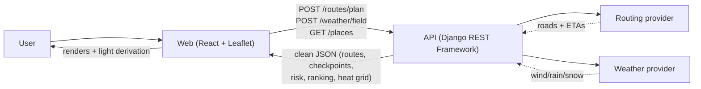
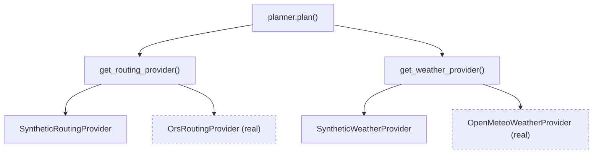
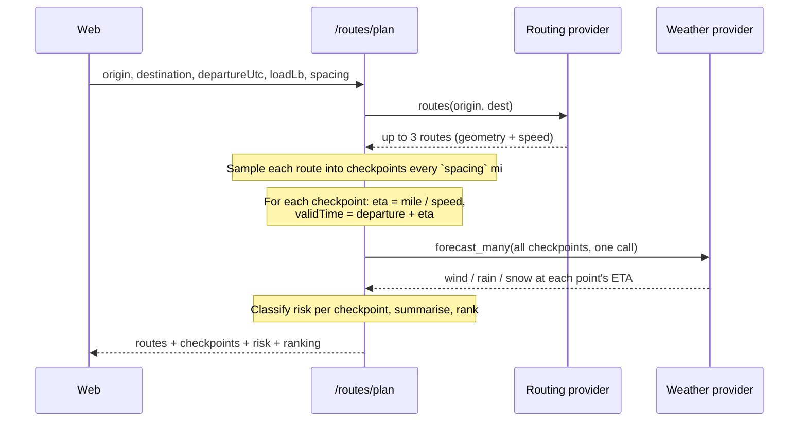
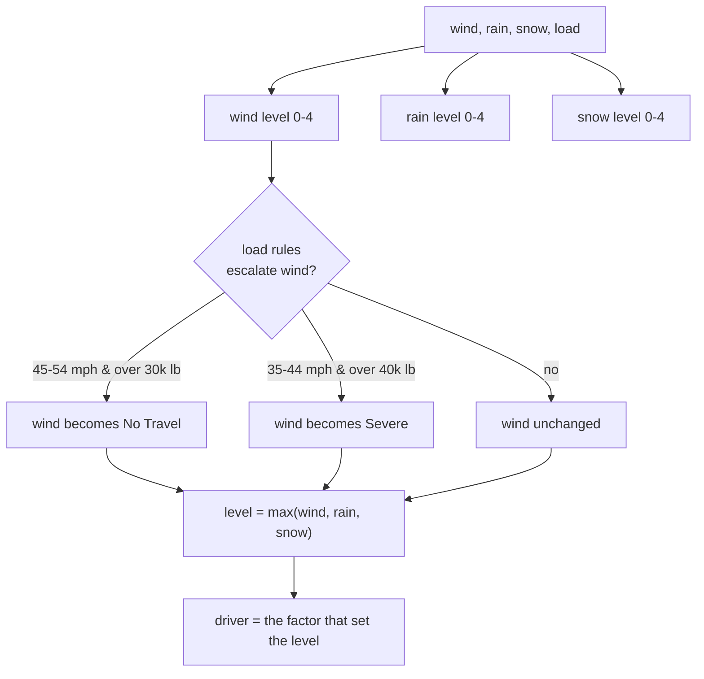
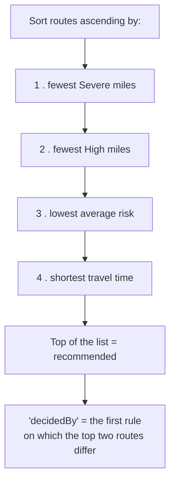
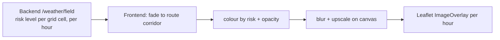
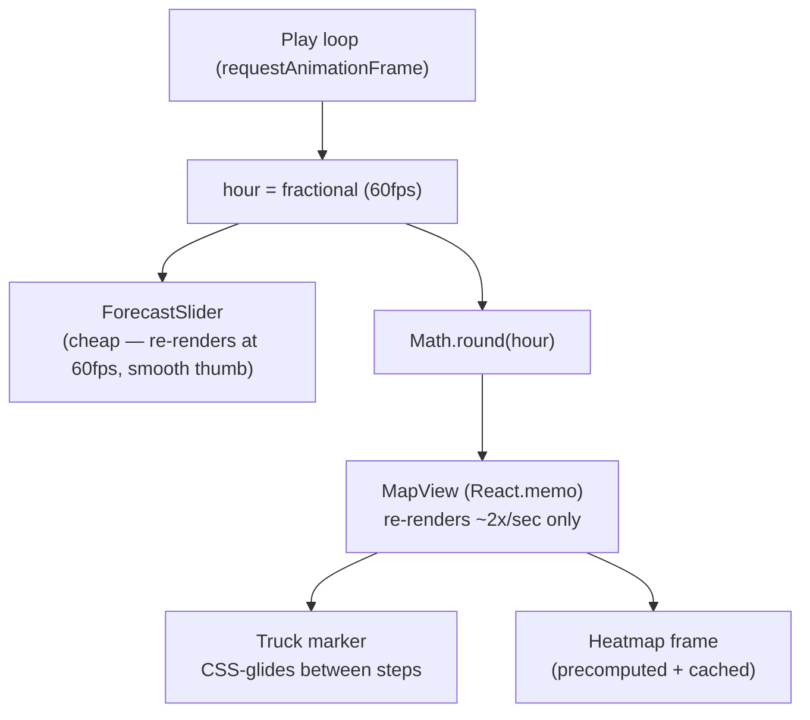

# Truck Routing — Build Walkthrough & Design Decisions

A weather-aware truck route planner: pick an origin, destination, departure time
and load, and it generates route options, scores each one against the weather
along the way, and recommends the safest route — with a map, per-checkpoint
detail, and an animated 0–48 h weather heatmap.

This doc is written to be *talked through*. It's organized around the four
evaluation areas, and every section explains **what** we did and **why** we chose
it — including the trade-offs, which is usually what the interviewer is really
probing.

- [1. The 10-second mental model](#1-the-10-second-mental-model)
- [2. Architecture](#2-architecture)
- [3. Routes, weather, risk & recommendation (40%)](#3-routes-weather-risk--recommendation-40)
- [4. Map & heatmap — smoothness & performance (40%)](#4-map--heatmap--smoothness--performance-40)
- [5. Code quality (15%)](#5-code-quality-15)
- [6. The decisions that matter](#6-the-decisions-that-matter)
- [7. Limitations & what I'd do next](#7-limitations--what-id-do-next)

---

## 1. The 10-second mental model

> **The backend does the thinking; the frontend does the drawing.**

The Django backend owns all the "logic" — calling the routing and weather
providers, sampling checkpoints, scoring risk, and ranking routes. It returns
clean, display-ready JSON. The React frontend consumes that and only does *visual*
derivation (drawing coloured road segments, animating the truck, colouring the
heatmap). There is **no business logic duplicated on the frontend** — that was a
deliberate rule, and it's why the two sides can't disagree.



---

## 2. Architecture

A **monorepo** with two apps and a shared contract:

```
truck-routing/
├── apps/
│   ├── web/     React 19 + Vite + react-leaflet   (the UI)
│   └── api/     Django 5.2 + DRF (stateless, no DB) (the brain)
└── docs/
    └── API.md   the wire contract between them
```

**Why a monorepo?** One repo, one history, the frontend and backend evolve
together, and the contract (`docs/API.md`) lives next to both. The two apps are
independently deployable.

**Why is the API stateless (no models, no database)?** It's a *compute/proxy*
service — it calls providers, computes, and returns. Nothing is persisted, so
there are no Django models, no migrations, and no DB. That keeps it simple and
horizontally scalable. (A DB would only appear if we added users / saved trips.)

**The contract is camelCase + UTC.** All times are ISO-8601 UTC on the wire;
the frontend converts to the viewer's timezone for display. Keys are camelCase
(Python stays snake_case; a renderer converts at the edge). This keeps the API
idiomatic for a JS client without making the Python ugly.

### The provider pattern (the key design idea)

Routing and weather are each behind a **swappable provider interface**. There's a
synthetic implementation (keyless, deterministic) and a real one, chosen by a
setting. Nothing else in the code changes when you swap.



This is why we could build and test the whole pipeline with zero API keys, then
flip to real data later with a one-line config change — the planner never knew
the difference.

---

## 3. Routes, weather, risk & recommendation (40%)

This is the core. Here's the full `/routes/plan` pipeline, which is where ~40% of
the grade lives:



### 3.1 Generate route options

We call a routing provider for the candidate routes. **Reality check that's worth
knowing for the interview:** we integrated the real **OpenRouteService** API
(truck/HGV profile — it respects truck restrictions, so ETAs are realistic), but
its *free tier only returns alternative routes for trips under 100 km* (error
2004). A long-haul trip like Dallas→Minneapolis (~1,600 km) comes back as **one**
route.

Since the whole point of the app is *comparing* routes, we default to a
**synthetic router** that produces three plausible corridors (a direct route plus
a west and east alternate), and keep ORS swappable for short trips or a
self-hosted engine. That's an honest engineering trade-off: *real roads for one
route* vs *three routes to compare*. The provider pattern means switching is one
setting. (Self-hosting Valhalla/OSRM removes the 100 km cap — the "proper" fix.)

### 3.2 Sample weather at the truck's ETA — not "now"

For each route we walk the polyline in `spacing`-mile steps (10 / 25 / 50, the
user picks), plus the destination. The subtle, important bit:

```
eta_hours = mileMarker / routeSpeed          # how long to reach this point
validTime = departureUtc + eta_hours         # the ABSOLUTE time the truck is there
weather   = provider.forecast(lat, lon, validTime)
```

So mile 500 on a 60 mph route is scored against the forecast **8 hours after
departure**, not the weather at request time. That's exactly what makes it a
*routing* weather tool and not a "current conditions" map.

**Performance decision:** a naïve version would call the weather API once per
checkpoint — ~40 per route × 3 routes = ~120 HTTP calls, which was slow and
tripped rate limits (a plan took 38 s and timed out). We **batch every checkpoint
across all routes into one Open-Meteo call** (it accepts many lat/lons at once),
so a plan is **~1 second**. This single change was the difference between "works"
and "unusable".

### 3.3 Risk rules

Each checkpoint's weather is classified into a level 0–4 by taking the **worst of
wind / rain / snow**:

| Level | Wind gust | Rain | Snow |
|---|---|---|---|
| 0 Low | `< 25 mph` | `< 0.10 in/hr` | `< 0.5 in/hr` |
| 1 Moderate | `25–34` | `0.10–0.24` | `0.5–0.9` |
| 2 High | `35–44` | `0.25–0.49` | `1.0–1.9` |
| 3 Severe | `45–54` | `0.50–1.00` | `2.0–3.0` |
| 4 No Travel | `≥ 55` | `> 1.00` | `> 3.0` |

Then the **load-weight rules** escalate wind risk for heavy trucks (wind catches a
loaded trailer):

- 45–54 mph wind **and** load > 30,000 lb → **No Travel**
- 35–44 mph wind **and** load > 40,000 lb → **Severe**



The `driver` (which of wind/rain/snow caused the level) is surfaced in the UI so a
dispatcher sees *why* a checkpoint is risky. This logic lives in **one place**
(the backend `scoring.classify`) and is reused by both the route checkpoints and
the heatmap grid, so they can never disagree.

### 3.4 Recommend the best route

We rank routes by sorting ascending on four keys, in order — **risk first, time as
the tie-breaker**:



So a route that's a bit slower but avoids severe weather wins — which is the whole
"balance risk and time" ask. We also return `decidedBy` (which rule broke the tie)
and a one-line narrative, which the UI shows as a **"Why this route?"** table so
the recommendation is explainable, not a black box. Special case: if *every* route
stays Low the whole way, the fastest wins (there's no risk to weigh).

---

## 4. Map & heatmap — smoothness & performance (40%)

The other ~40%. Two parts: getting it on the map correctly, and keeping it smooth.

### 4.1 What's on the map

Everything is Leaflet layers over a keyless dark basemap (Esri "Dark Gray
Canvas"):

- **Routes** — the selected route is drawn as **per-segment coloured polylines**
  (each segment coloured by the higher risk of its two bounding checkpoints), with
  a dark "casing" underneath for contrast; unselected routes are grey.
- **Checkpoints** — dots coloured by risk; hover/click opens a themed popover with
  wind/rain/snow, the risk driver, and the ETA.
- **Truck** — a marker that moves along the route as you scrub the forecast.
- **Heatmap** — an image overlay of the weather-risk field (below).

**A nice separation:** the backend sends the *route geometry* + *checkpoints*; the
frontend **derives the coloured segments** by slicing the polyline between
checkpoints. So "where exactly the colour changes" is a rendering concern, not
something the API has to encode.

### 4.2 The heatmap

The heatmap answers "what's the weather risk *around* the corridor, and how does it
evolve over 48 hours?"



**Decision — who computes the grid?** We put the *classification* on the backend
(it returns a grid of risk levels), and the frontend does only the *visual* work
(mask to the corridor, colour, blur). That keeps risk logic in one place.

**Decision — why is the grid synthetic while checkpoints are real?** A real
per-cell forecast is ~5,800 point lookups *per frame* — no point API supports
that, and it'd be thousands of requests. So the route **checkpoints** (what the
ranking actually uses) are real Open-Meteo data, and the background heatmap is a
smooth synthetic approximation. Being able to articulate *why* a piece is
approximated — because the alternative is infeasible, not because we were lazy —
is exactly the kind of judgment that gets evaluated.

### 4.3 Smoothness & performance — the interesting part

The forecast slider plays 0→48 h, moving the truck and swapping the heatmap. The
naïve version was janky, and fixing it is a good story:

**The trap:** if "current hour" is a 60fps value and the whole `<MapView>`
re-renders on it, react-leaflet re-diffs ~150 layers (routes, ~100 checkpoints,
cities, badges) **every frame** → thousands of `setStyle` calls per second → jank.

**The fix — split the clock:**



Concretely:
- **Fractional hour** drives only the lightweight slider (smooth thumb + fill).
- The map gets the **rounded** hour and is wrapped in `React.memo`, so it only
  re-renders when the integer hour changes (~twice a second). The side panel is
  memoised too, so it doesn't re-render every frame either.
- The **truck CSS-glides** between those integer steps (`transition: transform`),
  so it looks continuous without a 60fps re-render — and the transition is
  disabled during zoom so it doesn't lag.
- Heatmap **frames are precomputed in the background** and cached as data-URLs, so
  scrubbing is instant (no per-frame canvas work).

**A real bug worth telling:** the truck used to *disappear and reappear* on play.
Cause: the markers had no React `key`s, so when the heat overlay mounted/unmounted
between frames, react-leaflet reconciled the map children **by index** and tore
down + recreated the markers. Fix: stable `key`s (`key="truck"`), so they're
matched by identity. Small fix, great "I can debug React reconciliation" signal.

Net result: continuous slider + gliding truck, with the map doing ~2 updates/sec
instead of 60.

---

## 5. Code quality (15%)

- **Pure, framework-free domain logic.** The risk/routing/weather math is plain
  functions with no React or Django imports, so it's unit-tested in isolation.
  (The frontend had a parity test that pinned the exact recommendation before the
  logic moved server-side.)
- **Provider interfaces** (§2) keep real vs synthetic swappable and mockable.
- **An adapter layer** maps the API DTO → the shape the components render
  (reconstructing coloured segments, truck interpolation, the risk bar). It's unit
  tested against a sample payload, so the contract is pinned.
- **Testing strategy:** backend unit tests for scoring/ranking + endpoint tests;
  the real providers (ORS, Open-Meteo) are tested with **mocked HTTP**, so the
  suite is deterministic and offline. Plan tests pin the synthetic provider for
  the same reason.
- **Graceful degradation:** if the weather provider is down, the plan doesn't 500
  — checkpoints are marked "no data" (grey + a banner) and routes/ETAs still
  return.
- **Separation of concerns** throughout: `services/` (providers), `scoring.py`
  (rules), `planner.py` (orchestration), `serializers.py` (validation) on the
  backend; `domain/`, `state/`, `components/` on the frontend.

---

## 6. The decisions that matter

A quick-reference table — these are the "why did you…?" answers.

| Decision | Why | Trade-off |
|---|---|---|
| **Backend does the logic, frontend only renders** | One source of truth; map and ranking can't disagree; easy to test | Frontend depends on the API being up |
| **Provider pattern (synthetic ⇄ real)** | Build/test with no keys; flip to real with one setting | A little indirection |
| **Synthetic routing by default** | ORS free tier caps alternatives at 100 km → long trips get 1 route; we need 3 to compare | Routes aren't real roads (ORS/self-host fixes it) |
| **Real weather (Open-Meteo), heatmap grid synthetic** | Checkpoints drive the decision → must be real; a real per-cell grid is ~5,800 lookups/frame = infeasible | Heatmap is an approximation of real conditions |
| **Batch all checkpoints into one weather call** | 120 calls → 1; 38 s → ~1 s; avoids rate limits | A little more orchestration in the planner |
| **Sample weather at the checkpoint's ETA** | It's a *routing* tool — weather *when the truck is there* | Needs absolute time handling (UTC everywhere) |
| **camelCase + UTC wire format** | Idiomatic JS client, unambiguous times, convert to local in the UI | A renderer/parser at the API edge |
| **Fractional hour for slider, rounded for map + memo** | Smooth 60fps slider without 60fps map re-renders | Truck snaps to whole hours (CSS-glide hides it) |
| **Real current time (not a pinned clock)** | Real forecasts only exist for ~now + 7 days | Demo isn't deterministic across days |
| **Graceful weather fallback** | A provider outage shouldn't break the whole plan | Shows "no data" instead of risk when weather is unavailable |

---

## 7. Limitations & what I'd do next

- **A/B/C on long routes with real roads** → self-host Valhalla or OSRM (removes
  the 100 km alternatives cap); flip the routing provider.
- **A real heatmap grid** → a coarse (0.5°) batched Open-Meteo field, or gridded
  model data (NOAA HRRR / GRIB) processed server-side.
- **Deployment** → Dockerfiles + compose (and from there, ECS). The app is
  containerisation-ready; nothing holds state.
- **Caching** → road routes are stable; caching ORS responses by (origin, dest)
  would stretch the free tier and cut latency.

---

### One-paragraph summary to open with

> It's a weather-aware truck router. The Django backend generates route options,
> samples each one into checkpoints, and scores the weather **at the truck's ETA**
> at each point — worst of wind/rain/snow, escalated for heavy loads — then ranks
> the routes by severe miles, then high miles, then average risk, then time, and
> returns clean JSON. The React/Leaflet frontend draws the routes coloured by
> risk, the checkpoints, a moving truck, and an animated weather heatmap on a
> 0–48 h slider. The interesting engineering was (1) batching ~120 weather lookups
> into one call to make a plan ~1 s, and (2) keeping the forecast animation smooth
> by driving the slider at 60fps but the memoised map at ~2fps with a CSS-glided
> truck. Everything real-vs-synthetic sits behind a provider interface, so it was
> built keyless and flipped to real data (OpenRouteService + Open-Meteo) with a
> config change.
